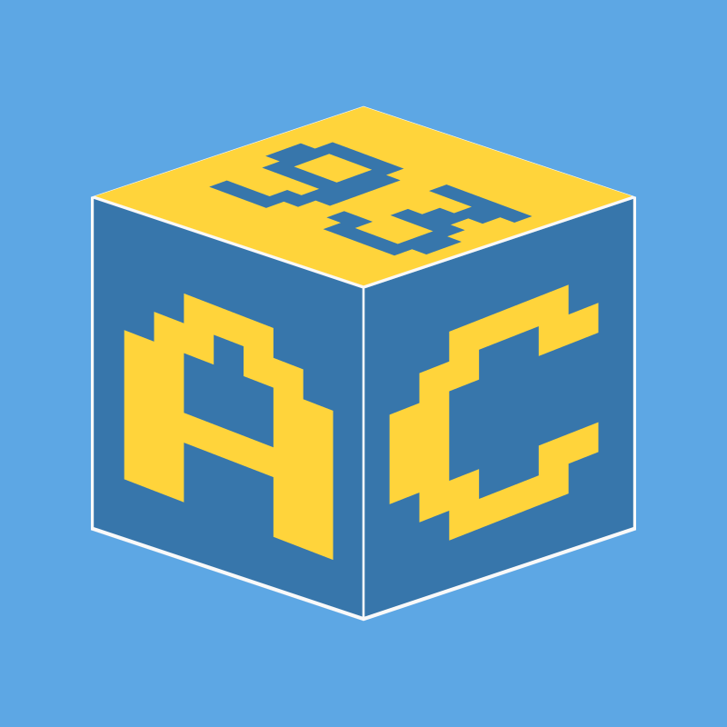

# Appcraft



Appcraft is a code generator for Python projects: `appcraft init` scaffolds a new project already organized into Clean Architecture layers (domain, application, infrastructure, presentation, runners), and from there you keep developing inside it like any other Python project. It is not a library your code imports at runtime, beyond a handful of small utilities the generated project ships with itself.

## Why Use It

- **A consistent structure from the first commit.** Business rules (domain/application) stay separate from frameworks and storage (infrastructure), so a project doesn't accumulate ad hoc structure as it grows, and the same conventions apply whether you built it alone or picked it up from someone else.
- **Add only what the project needs.** Functionality comes from composable **templates** — `flask_api`, `sqlalchemy`, `docker`, `git`, and more. Installing one drops its files and wires itself in automatically: a new Flask route or a new SQLAlchemy model is picked up without touching a central registration file.
- **Swap infrastructure without rewriting business logic.** Interchangeable templates sit behind the same contract (a `Port`) — `sqlalchemy`/`mongodb` for the database, `selenium`/`playwright`/`httpx`/`curl_cffi` for web scraping. Changing which one is installed, or which one a config file prefers, doesn't change the use case that calls it.
- **One command style for every feature.** Every command, from the application's own entry points to one-off maintenance tasks, runs through the same **runner** system: an interactive menu for a human, and `interactive=false` with `key=value` arguments for a script or CI.
- **You own what gets generated.** Every file Appcraft drops is plain, readable Python in your project. Templates only keep checking each other's presence at runtime (`is_installed()`) so they can adapt to what's installed — Appcraft itself doesn't need to run again once the project exists, except when you choose to add another template.

Use it when starting a new service or tool that's worth keeping organized as it grows. For a quick throwaway script, the scaffolding is more than you need.

## Quick Start

```bash
pip install --pre appcraft   # pre-release while 1.0.0 is still in beta

mkdir my-project && cd my-project
appcraft init flask_ui flask_api sqlalchemy docker
```

`<template_names>` can be any combination of the available templates, separated by spaces — see [Templates](https://duxtec.github.io/appcraft/latest/templates/index.html) for the full list. `appc` is a shorter alias for `appcraft`, and inside a generated project, `appc run <module> <method>`/`appc tools <module> <method>` run its own `run`/`tools` launchers.

```bash
appcraft list_templates        # see every available template
appcraft add_template <name>   # add one to a project that already exists
```

## Documentation

- [Documentation](https://duxtec.github.io/appcraft/latest/index.html)
- [Getting Started](https://duxtec.github.io/appcraft/latest/getting_started.html)
- [Templates](https://duxtec.github.io/appcraft/latest/templates/index.html)
- [Architecture](https://duxtec.github.io/appcraft/latest/architecture/index.html)
- [Contribute](https://duxtec.github.io/appcraft/latest/contributing/index.html)
- [Changelog](https://duxtec.github.io/appcraft/latest/changelog.html)
- [Contact](https://duxtec.github.io/appcraft/latest/contact.html)

`latest` always points at the newest released version; past versions stay available from the [version selection page](https://duxtec.github.io/appcraft/latest/versions/index.html).

## License

MIT — see [LICENSE](LICENSE).
